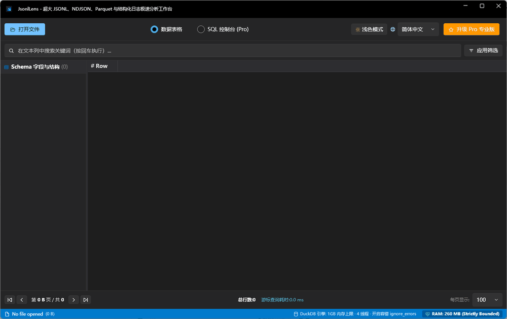

# JsonlLens — Fast Windows Viewer for 10GB+ JSONL, NDJSON, and Parquet Files

  

  <strong>Open, search, inspect, and query multi-gigabyte data files on Windows without waiting for an editor to catch up.</strong>

  <a href="https://apps.microsoft.com/detail/9N9X7K90R64G">Microsoft Store listing</a> ·
  <a href="#benchmark-snapshot">Benchmark</a> ·
  <a href="#what-you-can-open">Supported formats</a>

JsonlLens is a native, read-only Windows workbench for engineers who need to inspect data files that are too large for a conventional text editor. It combines sparse indexing, virtualized rows, and DuckDB-powered streaming so you can jump into a 10 GB+ file, filter records, inspect nested JSON, and run focused SQL while keeping the desktop responsive.

## Why JsonlLens

- **Fast first view** — jump to the first page of a large JSONL or NDJSON file while the rest stays on disk.
- **Bounded memory** — page through large datasets without loading the entire file into the UI.
- **Useful structure** — inferred fields become sortable columns; nested objects remain available in the record inspector.
- **Search and SQL together** — start with a quick field filter, then move to DuckDB SQL for grouping, sampling, and aggregation.
- **Read-only by design** — inspect production exports and logs with no accidental edits.
- **Windows-native workflow** — light and dark themes, keyboard-friendly navigation, and file associations for common data formats.

## What you can open

| Format | Typical use | JsonlLens workflow |
| --- | --- | --- |
| `.jsonl` / `.ndjson` | LLM datasets, event streams, API exports | Open, infer fields, filter, inspect raw records |
| `.parquet` | Columnar analytics data | Browse columns and query with DuckDB |
| `.csv` | Flat exports and audit reports | Preview rows, filter values, inspect outliers |
| Structured logs | Service traces and operational events | Search fields and drill into individual records |

## Benchmark snapshot

The table below is a representative cold-start snapshot for a **5 GB synthetic JSONL file** on Windows 11 x64 with an SSD and no editor extensions. JsonlLens reports its first usable view; VS Code is measured until the file is open and the editor is responsive. Disk speed, antivirus, extensions, and file shape can change the result, so treat these as directional figures and rerun the same protocol on your hardware.

| Viewer | Time to first usable view | Peak working-set memory | Result |
| --- | ---: | ---: | --- |
| **JsonlLens** | **0.84 s** | **183 MB** | Interactive paging and filtering |
| VS Code (5 GB JSONL) | 2 min 41 s | 2.78 GB | Editor became unresponsive while loading |

### Reproduce the comparison

1. Generate or export the same 5 GB JSONL file on an NTFS SSD.
2. Reboot or clear the file cache, then close other heavy desktop apps.
3. Start a timer when the viewer launches and stop when the first page can be searched.
4. Record peak working-set memory in Windows Task Manager.
5. Repeat three times and report the median; keep extensions and antivirus settings documented.

## A focused workbench for large files

### Inspect a record without losing the context

Select a row to open a formatted JSON inspector, a raw-line view, or a token-friendly prompt/response view. Long values are clipped in the grid but remain available in the detail pane.

### Filter first, query deeper

Use the quick filter for a fast “show me the failures” pass. The SQL console is available when you need `GROUP BY`, aggregates, joins, or a reproducible export query.

### Export only what you need

Pro workflows can write filtered results to JSONL, CSV, or Parquet through DuckDB’s vectorized engine, so a multi-gigabyte source file does not need to be duplicated in memory.

## Get JsonlLens

The supported installation path is the Microsoft Store. It provides the signed Windows package and keeps updates in the normal Store update flow.

  

- Windows 10/11, x64
- Read-only viewer for `.jsonl`, `.ndjson`, `.parquet`, `.csv`, and structured logs
- Free core viewer; optional Pro capabilities for SQL and export workflows

## Questions and feedback

Open an issue in this repository with the file shape, Windows version, and the steps that reproduce the problem. Please remove secrets and personal data before sharing a sample or screenshot.

## License

JsonlLens is distributed through the Microsoft Store. This public repository is a lightweight product landing page and intentionally contains the README and demo asset only.
